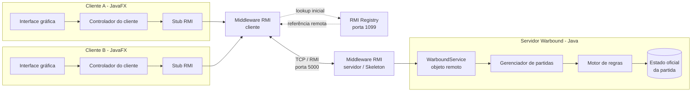
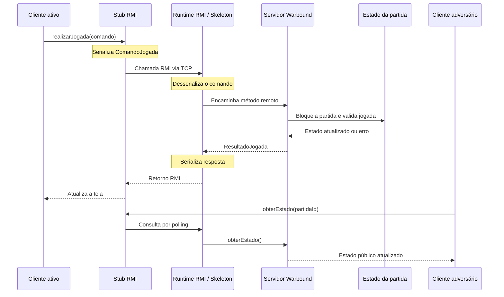

# Warbound - Entrega 1: Introdução e Arquitetura

## 1. Introdução

### 1.1 Descrição do jogo

**Warbound** é um card game multiplayer estratégico para dois jogadores. Cada participante escolhe uma civilização histórica - inicialmente Romanos, Samurais ou Vikings - e utiliza um baralho temático formado por unidades, táticas e líderes.

Cada jogador controla um comandante com 20 pontos de vida. No próprio turno, recebe recursos, pode baixar unidades, usar táticas, declarar ataques e encerrar o turno. A partida termina quando a vida do comandante adversário chega a zero ou quando outra condição de fim definida pelas regras for atingida.

Uma jogada é uma ação encaminhada ao servidor, como jogar uma carta, atacar, escolher um alvo, ativar um efeito ou encerrar o turno. O servidor é a autoridade do jogo: somente ele valida custo, turno, carta, alvo e efeitos antes de modificar o estado oficial da partida.

### 1.2 Motivação da escolha do protocolo

O protocolo escolhido é o **Java RMI (Remote Method Invocation)**. Warbound possui um domínio orientado a objetos, com entidades como `Partida`, `Jogador`, `Carta`, `Baralho`, `Jogada` e `EstadoPartida`. O RMI permite que o cliente invoque métodos em um objeto remoto, enquanto o middleware realiza a comunicação pela rede e a serialização dos objetos.

A aplicação usará Java 17+ no cliente e no servidor, com JavaFX para a interface. Nesse cenário, o RMI reduz a complexidade de integração, pois permite transferir DTOs serializáveis sem criar uma camada adicional de conversão para JSON ou Protocol Buffers. O RMI Registry também oferece um mecanismo simples para os clientes localizarem o serviço remoto.

## 2. Arquitetura da Solução

O sistema seguirá o modelo cliente-servidor. O servidor central hospeda as partidas e mantém o estado autoritativo; clientes enviam intenções de jogada e apenas exibem o resultado devolvido pelo servidor.

### 2.1 Diagrama da arquitetura

**Figura 1 - Diagrama da arquitetura da solução.**  
Fonte: Elaborado pelos autores (2026).

| Componente | Responsabilidade |
| --- | --- |
| Cliente JavaFX | Exibe mão, tabuleiro, vida, recursos e mensagens. |
| Controlador do cliente | Transforma ações da interface em comandos de jogada. |
| Stub RMI | Representa o objeto remoto no cliente e encaminha chamadas. |
| RMI Registry | Registra e permite localizar o serviço `WarboundService`; é usado na conexão inicial. |
| Middleware RMI | Serializa, transmite e desserializa objetos entre processos. |
| Skeleton/runtime RMI | Recebe a chamada no servidor e a encaminha ao serviço remoto. Em Java RMI atual, essa função é fornecida pelo runtime. |
| `WarboundService` | Porta de entrada remota para as operações do jogo. |
| Gerenciador de partidas | Localiza a partida, jogadores e sessões correspondentes. |
| Motor de regras | Valida turno, custo, ataques, efeitos e vitória. |
| Estado oficial | Mantém baralhos, mãos privadas, campo, vida, recursos, turno e histórico. |

### 2.2 Fluxo de mensagens a cada jogada

**Figura 2 - Fluxo de mensagens de uma jogada.**  
Fonte: Elaborado pelos autores (2026).

1. O jogador seleciona uma carta, ataque ou ação na interface.
2. O cliente cria um `ComandoJogada` com partida, jogador, ação, carta, alvo e versão do estado conhecida.
3. O Stub RMI serializa o comando e o envia ao servidor por TCP.
4. O runtime RMI recebe, desserializa e encaminha a chamada ao `WarboundService`.
5. O servidor localiza a partida, sincroniza seu acesso e valida a ação com o motor de regras.
6. Se a ação for válida, o servidor altera o estado oficial e produz um `ResultadoJogada`; caso contrário, devolve um erro de regra.
7. O resultado é serializado pelo runtime RMI e retorna ao cliente que realizou a ação.
8. O cliente atualiza sua interface. O adversário consulta o estado por polling e recebe apenas a visão permitida para ele.

### Decisões arquiteturais iniciais

- A primeira versão suporta duas pessoas por partida.
- Cada partida possui estado isolado e uma versão incremental do estado.
- O servidor não entrega a mão ou informações privadas de um jogador ao adversário.
- O servidor processa uma jogada por vez em cada partida, evitando atualizações concorrentes conflitantes.
- A atualização do adversário será feita por polling na primeira versão; callbacks RMI podem ser adicionados em uma etapa futura.
